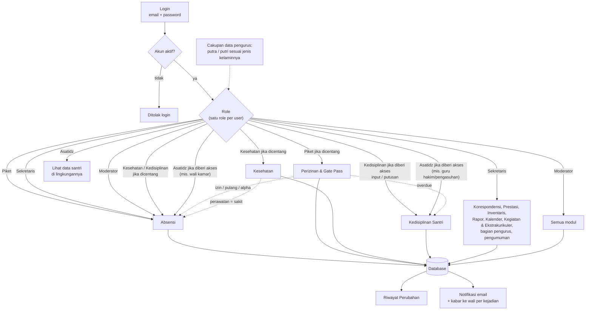
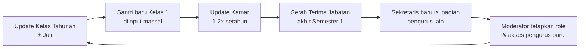
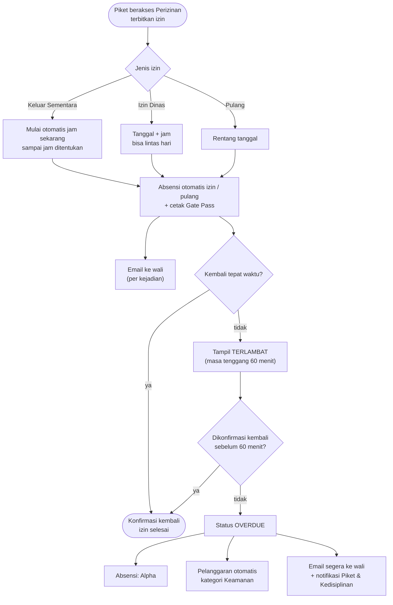
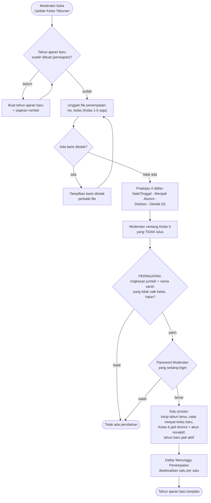
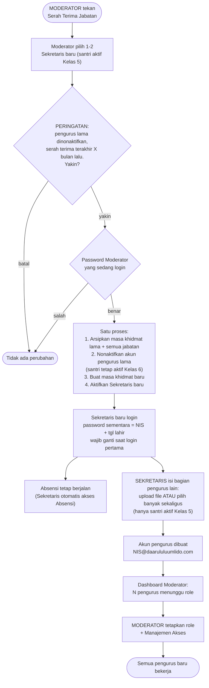
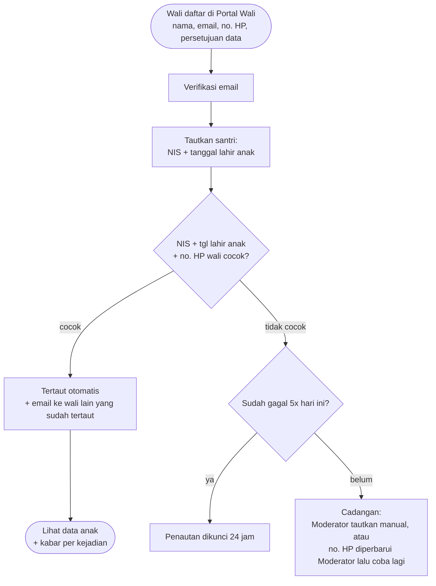

# Perkuat dari dasar (Mindmap & flowchart)
### Perkuat konsep inti
Abaikan jabatan, fokus kepada objek (sistem yang abadi tetap berjalan dan diperlukan dalam kegiatan HISADA)
### Ringkasan Singkat Alur
(Software Development Life Cycle (SDLC)) : Mindmap (Ide Besar) ➔ Analisis (Detail Fitur) ➔ Flowchart (Logika Jalannya Program) ➔ Desain Database (Penyimpanan Data) ➔ Coding (Pembuatan Program) ➔ Testing (Pengecekan Error) ➔ Deployment (Rilis Aplikasi).

# Sistem Hisada
### Himpunan Santri Daarul Uluum Lido — Sistem Informasi Manajemen Kesantrian

Teknologi: **Cloudflare Workers + D1** (SQLite), tanpa framework dan tanpa build-tool; tampilan Vue 3 di-vendor lokal. Login dengan **akun Google pondok** (OAuth) atau password cadangan. Aplikasi: https://hisada.216326.workers.dev

> **Status dokumen (31 Oktober 2026):** dokumen ini berisi **hasil desain sistem** (Mindmap, Analisis, Flowchart) yang sudah disepakati. **Belum ada kode** yang mengikuti desain ini; kode PHP lama sudah dihapus dari repo pada 27 Oktober 2026 (lihat [Status Implementasi](#status-implementasi)). Tampilan bisa dicoba lewat [Prototipe Tampilan](#prototipe-tampilan). Hal yang belum diputuskan dikumpulkan di [Belum Diputuskan](#belum-diputuskan).

---

## Mindmap (Ide Besar)

Sistem dikelompokkan berdasarkan **objek/proses yang permanen**, bukan jabatan (jabatan berganti setiap Serah Terima). Pohon dipisah menjadi dua: **Administrasi** (urusan yang dicatat) dan **Fungsi** (kemampuan sistem).

### Administrasi

Urusan kesantrian yang **dicatat** di sistem.

```text
Administrasi HISADA
├── Data Master
│   ├── Data Santri
│   │   ├── Biodata & status
│   │   └── Keluarga & kontak wali
│   ├── Data Guru / Asatidz
│   ├── Data Kelas
│   │   ├── Tingkat 1–6 + rombel + jenjang (MTs/SMP · MA)
│   │   └── Wali kelas (per tahun ajaran)
│   ├── Data Asrama & Kamar
│   ├── Tahun Ajaran: persiapan · aktif · arsip
│   └── Daftar Pilihan (per kelompok, bisa diedit tanpa ubah kode)
├── Kesantrian
│   ├── Absensi
│   │   ├── Absensi Harian (per kamar)
│   │   └── Absensi Kegiatan (per grup)
│   ├── Perizinan
│   │   ├── Keluar Sementara · Izin Dinas · Pulang
│   │   ├── Gate Pass
│   │   ├── Overdue (setelah masa tenggang 60 menit)
│   │   └── Libur Pondok (izin pulang massal)
│   ├── Kesehatan
│   │   ├── Kunjungan: Rawat Jalan · Perawatan
│   │   ├── Pemeriksaan: diagnosa, resep, tindak lanjut
│   │   └── Analisis musim sakit
│   ├── Kedisiplinan
│   │   ├── Input Pelanggaran
│   │   └── Sidang & Vonis: Ringan · Sedang · Berat · Pemutihan
│   ├── Pengembangan Diri
│   │   ├── Prestasi Santri
│   │   └── Kegiatan & Ekstrakurikuler
│   │       └── Pramuka · Muhadhoroh · Halaqah Qur'an · Olahraga · Kesenian
│   └── Laporan Santri
│       └── Rapor Kesantrian: 90 hari · 1 tahun ajaran
└── Tata Warkat
    ├── Kalender Akademik
    ├── Korespondensi: surat keluar · surat masuk
    └── Inventaris Barang: kode barang → unit fisik
```

### Fungsi

Kemampuan **sistem** yang melayani seluruh administrasi di atas.

```text
Fungsi Sistem HISADA
├── Akses
│   ├── Login & Akun
│   │   ├── Password sementara: NIS + tanggal lahir
│   │   └── Wajib ganti saat login pertama
│   └── Kelola User & Role
│       ├── Role: Piket · Kesehatan · Kedisiplinan · Sekretaris · Asatidz · Moderator
│       └── Manajemen Akses: akses di luar role, per orang (hanya Moderator)
├── Pengolahan Data
│   ├── Update Data & Import
│   │   ├── Upload file (CSV)
│   │   ├── Pilih banyak → ubah satu kategori (mis. kelas, kamar)
│   │   └── Jabatan pengurus: Serah Terima (semua) · PAW (satu orang)
│   └── Cari Santri & Cari Guru
├── Pemantauan
│   ├── Dashboard & Statistik
│   └── Riwayat Perubahan
├── Komunikasi
│   ├── Notifikasi (email)
│   └── Portal Wali Santri
└── Keberlanjutan
    ├── Backup Database
    └── Export Excel
```

---

## Daftar Isi

- [Mindmap (Ide Besar)](#mindmap-ide-besar)
- [Posisi Tahap SDLC](#posisi-tahap-sdlc)
- [Lingkungan Pondok](#lingkungan-pondok)
- [Prototipe Tampilan](#prototipe-tampilan)
- [Flowchart Sistem](#flowchart-sistem)
- [Role, Manajemen Akses & Cakupan Data](#role-manajemen-akses--cakupan-data)
- [Siklus Tahunan](#siklus-tahunan)
- **Modul — Administrasi**
  - Data Master — [Data Master](#data-master) · [Tahun Ajaran](#tahun-ajaran)
  - Kesantrian — [Absensi](#absensi) · [Perizinan](#perizinan-1) · [Kesehatan](#kesehatan) · [Kedisiplinan](#kedisiplinan) · [Prestasi Santri](#prestasi-santri) · [Kegiatan & Ekstrakurikuler](#kegiatan--ekstrakurikuler) · [Rapor Kesantrian](#rapor-kesantrian)
  - Tata Warkat — [Kalender Akademik](#kalender-akademik) · [Korespondensi](#korespondensi) · [Inventaris Barang](#inventaris-barang)
- **Modul — Fungsi**
  - Akses — [Login & Akun](#login--akun) · [Kelola User & Role](#kelola-user--role)
  - Pengolahan Data — [Update Data & Import](#update-data--import) · [Update Kelas Tahunan](#update-kelas-tahunan) · [Update Kamar](#update-kamar) · [Masa Khidmat & Serah Terima Jabatan](#masa-khidmat--serah-terima-jabatan) · [Pergantian Antar-Waktu (PAW)](#pergantian-antar-waktu-paw) · [Cari Santri & Cari Guru](#cari-santri--cari-guru)
  - Pemantauan — [Dashboard & Statistik](#dashboard--statistik) · [Riwayat Perubahan](#riwayat-perubahan)
  - Komunikasi — [Notifikasi](#notifikasi) · [Portal Wali Santri](#portal-wali-santri)
  - Keberlanjutan — [Backup Database](#backup-database) · [Export Excel](#export-excel)
- [Belum Diputuskan](#belum-diputuskan)
- [Status Implementasi](#status-implementasi)
- [Struktur Repo](#struktur-repo)

---

## Posisi Tahap SDLC

| Tahap | Status |
|---|---|
| Mindmap | ✅ Selesai |
| Analisis | ✅ Sebagian besar selesai (sisa: lihat [Belum Diputuskan](#belum-diputuskan)) |
| Flowchart | ✅ Selesai untuk alur utama |
| Desain Database | ⏳ Sedang disusun (draf) |
| Coding · Testing · Deployment | ⬜ Belum dimulai |

---

## Lingkungan Pondok

> Hasil brainstorming **lingkungan nyata** pondok (8 Oktober 2026): siapa saja pelakunya, unit apa saja yang ada, kegiatan apa yang berjalan, dan siapa yang mencatat apa. Bagian ini menjadi **dasar** desain sistem; bagian yang belum sejalan dengan desain di bawah dikumpulkan di [Belum Diputuskan](#belum-diputuskan).

### Pelaku

| Pelaku | Keterangan |
|---|---|
| **Santri** | Peserta semua kegiatan dan yang dinilai. Tidak punya akses sistem. |
| **Pengurus** | Santri juga: tetap tinggal di kamar, ikut kelas, dan **tetap dinilai** di beberapa kegiatan. Bekerja per **bagian** (Perbadatan, Bahasa, Keamanan, Dapur, dst.); bagian adalah pembagian kerja, **bukan** patokan role. |
| **Guru** | Lazim memegang **banyak peran sekaligus** tanpa batasan: wali kamar, wali kelas, pengajar, guru tahsin, pelatih, pengontrol kegiatan, guru pengasuhan, hakim. |
| **Lembaga guru** | BPPS, BPK-TMI, BPPK, Mabikori (Pramuka), Bidang Pengajaran TMI, Bidang Pembinaan & Pengasuhan. Khusus guru, bagian dari pesantren. |
| **Dokter** | Datang pada jadwal tertentu atau saat darurat. |

Seluruh lingkungan **dipisah putra dan putri**.

### Unit & kelompok

| Unit | Anggota | Penyusun anggota |
|---|---|---|
| **Rayon** (asrama) → kamar | Santri + guru wali kamar | Pengurus |
| **Kelas** (1A, 1B, …) | Santri + wali kelas + pengajar materi | Pengurus |
| **Kelompok tahsin** | Santri + pengurus + guru pengoreksi | Pengurus |
| **Kelompok muhadhoroh** | Santri + pengurus pengatur + guru pengontrol | Pengurus |
| **Ekskul** | Santri + guru pelatih | Pengurus |
| **Pramuka**: DLT 1, 2, … → sub-kelompok | Santri + pengurus pembimbing + guru pengontrol | Pengurus |
| **Marhalah** | Pengelompokan fleksibel (per kelas, per grup, dll.) | — |

- Perubahan anggota bersifat **insidentil**, mengikuti ketentuan masing-masing bagian.
- Santri yang pindah kelompok membawa **catatan/nilainya**, lalu berlanjut di kelompok baru.

### Kegiatan & absensi

| Kegiatan | Waktu | Diabsen oleh |
|---|---|---|
| Shalat berjamaah (5 waktu) | — | Tidak diabsen |
| Tasywidul mufrodat / muhadatsah | Ba'da subuh | Pengurus |
| KBM (pagi & siang) | Pagi & siang | Guru |
| Kegiatan sore / ekskul | Sore | Guru |
| Halaqoh tadarus (tahsin), per kelompok | Ba'da maghrib | Guru |
| Belajar malam, di kelas | Ba'da isya | Wali kelas |
| Muhadhoroh | Senin malam & Jumat siang | Pengurus |
| Pramuka | Sabtu siang | Pengurus |
| Absensi malam / harian | Sebelum tidur | Wali kamar atau pengurus, bergantian |

- Santri yang melewatkan kegiatan karena sakit dicatat **tidak hadir**.
- Keaktifan ekskul **disatukan dengan absensi**.

### Penilaian

| Bidang | Yang dinilai |
|---|---|
| **Ekskul** | Prestasi lomba + keaktifan (absensi) |
| **Syakia** | Setoran surat/doa yang ditentukan **per kelas**; setoran fleksibel, **wajib 2 jenis per semester** |
| **Tahsin** | Bacaan dari halaman sampai halaman, dan jumlah khatam (dicatat guru) |
| **Muhadhoroh** | Bahasa (Indonesia, Arab, Inggris) + kelancaran; tampil bergiliran per grup |
| **Pramuka** | Keaktifan menyetor SKU & SKK |

### Mahkamah

- **Santri:** pengurus mengajukan tuntutan → guru **hakim** menimbang dan menentukan hukuman.
- **Pengurus:** pelanggarannya dicatat oleh **guru pengasuhan** yang memiliki hak menginput pelanggaran.
- **Pembatalan:** setiap penginput dapat membatalkan inputnya dalam **1 jam**. Setelah santri dihukum, **pemutihan hanya oleh hakim**.
- Setiap malam ba'da isya, **Bagian Bahasa membacakan nama** seluruh pelanggar hari itu berdasarkan data hakim. Ini bukan mahkamah tersendiri.

### Layanan santri

- **Kesehatan:** santri sakit dibawa ke pusat kesehatan → didata pengurus jaga → diperiksa dokter (diagnosa + resep).
- **Makan:** sesuai menu harian. Santri yang tidak bisa makan menu biasa melapor ke dapur pusat, atau dibelikan oleh guru/pengurus.

### Perizinan

- **Bagian Keamanan** memegang seluruh perizinan: menerima pengajuan, mengizinkan, mencetak dan menandatangani Gate Pass, serta mencatat jam keluar dan jam kembali. Guru pengasuhan dan pihak terkait **hanya menerima notifikasi**.
- **Izin keluar** (beberapa jam) dan **izin pulang** (beberapa hari). Izin pulang **wajib didampingi wali santri**. Libur pondok bersifat massal, mengikuti kalender HISADA.
- **Terlambat kembali:** tanpa masa tenggang; kegiatan yang terlewat dicatat tidak hadir; keterlambatan **masuk mahkamah**; wali santri **segera diberi tahu**. *(Di sistem diberi masa tenggang 60 menit sebelum overdue, untuk mencegah kabar salah ke wali bila petugas terlambat mencatat kembali — lihat [Perizinan](#perizinan-1).)*

### Wali santri

- Santri **tidak boleh membawa HP**; komunikasi wali ↔ santri lewat **wali asuh** (perannya seperti wali santri / wali kelas).
- Titik kontak wali ke pondok: **wali kamar** dan **wali kelas**.
- Wali diberi tahu **per kejadian** (santri sakit, divonis hukuman berat, terlambat kembali, dll.), bukan rekap harian.
- **Kunjungan** waktunya tidak menentu, tetapi tetap dicatat.
- **Kiriman** uang/barang disimpan di tempat penitipan yang dijaga pengurus keamanan, dan dicatat.

### Jadwal harian

Mengacu pada *Jadwal Kegiatan Harian Santri* dalam Risalah HISADA 2025/2026, dengan perubahan terbaru. Jadwal disesuaikan bila ketetapan baru terbit.

| Jam | Senin–Sabtu | Variasi |
|---|---|---|
| 04.00–05.20 | Bangun, subuh berjamaah, wirid | Jumat Al-Kahfi |
| 05.20–05.45 | Tasywidul mufrodat | Rabu & Ahad muhadatsah |
| 05.45–07.00 | Mandi, sarapan, persiapan & bel masuk KBM | Ahad olahraga |
| 07.10–12.00 | KBM | Jumat s.d. 10.40; Ahad kerja bakti & latihan ekskul |
| 12.00–13.40 | Dzuhur, istirahat, makan siang | |
| 13.40–15.00 | KBM siang | Jumat muhadhoroh; Sabtu Pramuka; Ahad istirahat |
| 15.00–16.00 | Ashar, wirid, maklumat Bagian Bahasa | |
| 16.00–17.00 | Kegiatan sore / ekskul | |
| 17.00–18.30 | Mandi, makan malam, maghrib | |
| 18.30–19.15 | Halaqoh tadarus per kelompok | Kamis tahlil & yasinan; Ahad maulid |
| 19.15–19.45 | Isya, pembacaan nama pelanggar | |
| 19.45–21.00 | Belajar malam di kelas | Senin muhadhoroh; Kamis & Sabtu kajian kitab per marhalah |
| 21.00–22.00 | Muraja'ah mufrodat, tadarus qobla naum, absensi malam | |
| 22.00–04.00 | Wajib tidur | |

Kegiatan mingguan, semesteran, dan tahunan cukup dicatat di [Kalender Akademik](#kalender-akademik).

---

## Prototipe Tampilan

Prototipe tampilan yang bisa diklik untuk **13 layar** (Login, Dashboard, seluruh menu Administrasi dan Fungsi), memakai **data contoh** (nama fiktif, NIS/NIP palsu berawalan 99). Belum terhubung ke database. Sumber dan daftar layar: [prototipe/](prototipe/README.md).

- Sidebar mengikuti mindmap: **Beranda · Administrasi · Fungsi**.
- Bisa dilihat sebagai **role apa pun** (pilihan di sidebar); menu mengikuti Peta Akses.

---

## Flowchart Sistem

Alur dari login sampai modul yang bisa dibuka.



---

## Role, Manajemen Akses & Cakupan Data

### Role (satu role per user)

| Role | Pemegang | Modul |
|---|---|---|
| **Piket** | Pengurus santri | Absensi (otomatis) · Perizinan & Gate Pass (jika dicentang Moderator) |
| **Kesehatan** | Pengurus santri | Kesehatan (jika dicentang Moderator) · Absensi (jika dicentang) |
| **Kedisiplinan** | Pengurus santri | Kedisiplinan Santri (input dan/atau putusan, jika diberi akses) · Absensi (jika dicentang) |
| **Sekretaris** | Pengurus santri | Korespondensi, Prestasi, Inventaris, Rapor, Kalender (edit), Absensi, Kegiatan & Ekstrakurikuler, Riwayat Perubahan (masa jabatannya), isi bagian pengurus, pengumuman email |
| **Asatidz** | Guru | Lihat data santri di lingkungannya (tanpa data Kesehatan) |
| **Moderator** | Pihak pondok / tim IT (**bukan santri**) | Semua modul |

- **Jabatan ≠ role.** Jabatan (mis. "Ketua Bagian Keamanan") adalah label organisasi yang diisi Sekretaris. Role menentukan hak akses dan ditetapkan Moderator.
- **Role Moderator tidak pernah diberikan ke akun santri.** Jika ditemukan, role dicabut.

### Manajemen Akses (hanya Moderator)

- Peran atau akses **di luar role** diberikan per orang lewat **Manajemen Akses**. **Hanya Moderator (admin)** yang dapat mengelolanya.
- Berlaku untuk pengurus **dan guru**. Guru yang memegang banyak peran (hakim, guru pengasuhan, wali kelas, pengajar, dll.) diberi akses sesuai tugasnya lewat Manajemen Akses.
- Setiap pemberian/pencabutan akses tercatat di Riwayat Perubahan.

Akses yang sudah ditetapkan untuk role pengurus:

| Akses | Untuk role |
|---|---|
| Absensi | Kesehatan, Kedisiplinan · guru sesuai tugas (wali kamar, pelatih, guru halaqah) |
| Kesehatan | Kesehatan (role saja belum cukup — wajib diberi akses) |
| Perizinan | Piket |
| Input pelanggaran · Putusan kedisiplinan | Dipilih manual per orang (pengurus atau guru, mis. guru hakim) |
| Profil kesehatan (alergi, penyakit kronis) | Dipilih manual per orang |
| Edit daftar pilihan tertentu (mis. obat, diagnosa) | Dipilih manual per orang, per daftar |

### Cakupan data Putra / Putri
- Pengurus santri **otomatis** hanya melihat dan mengelola data santri sesuai **jenis kelaminnya** (putra → putra, putri → putri).
- Moderator melihat semua.
- Satu database; **setiap data ditandai lingkungan** putra/putri, **termasuk Tata Warkat** (Kalender, Korespondensi, Inventaris). Daftar pilihan, jabatan, dan guru boleh bernilai `semua` (K-88).

### Peta akses

Keterangan: ✔ otomatis · ☑ jika diberi lewat Manajemen Akses · 👁 lihat saja · ✖ tidak · ⏳ belum diputuskan

| Modul / Aksi | Piket | Kesehatan | Kedisiplinan | Sekretaris | Asatidz | Moderator |
|---|---|---|---|---|---|---|
| Dashboard, Kalender (lihat), Cari Santri/Guru | ✔ | ✔ | ✔ | ✔ | ✔ | ✔ |
| Kalender (edit) | ✖ | ✖ | ✖ | ✔ | ✖ | ✔ |
| Absensi harian & kegiatan | ✔ | ☑ | ☑ | ✔ | 👁 · ☑ (sesuai tugas) | ✔ |
| Perizinan & Gate Pass | ☑ | ✖ | ✖ | ✖ | 👁 | ✔ |
| Kesehatan | ✖ | ☑ | ✖ | ✖ | ✖ | ✔ |
| Kedisiplinan: input pelanggaran | ✖ | ✖ | ☑ | ✖ | ☑ | ✔ |
| Kedisiplinan: vonis & pemutihan | ✖ | ✖ | ☑ (bukan kasus yang ia catat) | ✖ | 👁 hasil vonis · ☑ guru hakim | ✔ |
| Korespondensi, Inventaris | ✖ | ✖ | ✖ | ✔ | ✖ | ✔ |
| Prestasi, Rapor | ✖ | ✖ | ✖ | ✔ | 👁 | ✔ |
| Kegiatan & Ekstrakurikuler (kelola) | ✖ | ✖ | ✖ | ✔ | ✖ | ✔ |
| Riwayat Perubahan | ✖ | ✖ | ✖ | ✔ (masa jabatannya) | ✖ | ✔ (semua) |
| Isi bagian pengurus, pengumuman email | ✖ | ✖ | ✖ | ✔ | ✖ | ✔ |
| Data Master (termasuk no. HP wali) | ✖ | ✖ | ✖ | ✖ | ✖ | ✔ |
| Edit daftar pilihan tertentu (mis. obat, diagnosa) | ☑ | ☑ | ☑ | ☑ | ☑ | ✔ |
| Profil kesehatan | ✖ | ☑ | ✖ | ✖ | ✖ | ✔ |
| Update Kamar, PAW | ⏳ | ⏳ | ⏳ | ⏳ | ✖ | ✔ |
| Update Kelas Tahunan, Serah Terima, role & akses, backup, email ke wali tertentu, tautkan wali manual | ✖ | ✖ | ✖ | ✖ | ✖ | ✔ |

---

## Siklus Tahunan



**Perjalanan satu angkatan pengurus:** diangkat di akhir Semester 1 saat **Kelas 5** → naik ke Kelas 6 dan **tetap menjabat** → diganti pada Serah Terima berikutnya, tetap santri aktif Kelas 6 tanpa jabatan → menjadi **Alumni** saat Update Kelas Tahunan.

---

# Modul — Administrasi

## Data Master

*(akses: Moderator; profil kesehatan & daftar pilihan tertentu lewat Manajemen Akses)*

| Data | Isi utama |
|---|---|
| **Santri** | NIS, nama, jenis kelamin, tempat/tanggal lahir, kelas, kamar, keluarga, status (aktif / alumni / mutasi keluar / skorsing / meninggal). Hanya santri program **TMI**. **NIK, No KK, penghasilan, dan NISN tidak disimpan** |
| **Guru / Asatidz** | NIP, nama, jenis kelamin, no. HP, lingkungan (putra / putri / semua) |
| **Kelas** | **Tingkat (1–6) + rombel (A, B, C, Intensif, …) + jenjang** (1–3: MTs/SMP, 4–6: MA), mis. 5B. Rombel **statis**; yang berganti tiap tahun hanya penempatan santri. Label **MIA/IIS** hanya tampilan di layar, tanpa logika. Rombel yang tidak dibuka dinonaktifkan |
| **Wali kelas** | Ditetapkan **per tahun ajaran** |
| **Asrama & kamar** | Asrama (rayon, dengan jenis kelamin) → kamar. Wali asuh + asisten ditetapkan **per tahun ajaran** |
| **Keluarga & kontak wali** | Nama ayah/ibu, no. HP. **No. HP wali hanya diubah Moderator** (no. HP adalah kunci penautan Portal Wali). Nomor WA ayah/ibu dari data 2026-2027 menjadi bahan pencocokan |
| **Daftar pilihan** | Isi dropdown di modul lain disimpan sebagai data, bukan kode: jenis izin, status kehadiran, sesi absensi, jenis kunjungan, tindak lanjut, obat, diagnosa, kategori pelanggaran, tingkat vonis, ekstrakurikuler, tingkat & hasil lomba. Pilihan > 2 tampil sebagai dropdown, 2 pilihan sebagai tombol. Pilihan yang sudah dipakai **dinonaktifkan, tidak dihapus** |

**Riwayat yang tidak pernah ditimpa:**
- **Riwayat kelas** — setiap masa tinggal di sebuah kelas, termasuk **pindah rombel** di tengah tahun (dicatat setiap kali + masuk Riwayat Perubahan).
- **Riwayat kamar** — setiap perpindahan kamar.
- **Status santri** — perubahan ke alumni / mutasi keluar / meninggal otomatis **menonaktifkan akun login**.

### Tahun Ajaran

*(akses: Moderator)*

- **Tahun ajaran** berstatus *persiapan* / *aktif* / *arsip*; hanya satu yang aktif. Tanggalnya **tidak tetap** (± Juli–Juni): tanggal mulai terisi saat Update Kelas Tahunan dijalankan, tanggal selesai saat Update Kelas Tahunan berikutnya.

---

## Kesantrian

### Absensi

*(akses: Piket otomatis · Sekretaris & Moderator otomatis · Kesehatan & Kedisiplinan jika dicentang)*

- **Absensi Harian** berbasis **kamar**: pilih kamar + tanggal (+ **sesi**, opsional; umumnya sekali sehari), isi status semua penghuni sekaligus.
- **Absensi Kegiatan**: Pramuka, Muhadhoroh, Halaqah Qur'an, Olahraga, Kesenian — berbasis anggota **grup** dari modul [Kegiatan & Ekstrakurikuler](#kegiatan--ekstrakurikuler). Santri boleh ikut **dua ekskul atau lebih**; tiap grup diabsen sendiri.
- Status **terisi otomatis** dari modul lain dan **terkunci** di form absensi:
  - Kesehatan (Perawatan) → **Sakit**, selama santri masih dirawat (bisa beberapa hari)
  - Perizinan → **Izin / Pulang**, overdue → **Alpha**
  - Santri berstatus **skorsing** → **Pulang** (keterangan: skorsing)
  - Bila bertemu: skorsing > perizinan/overdue > kesehatan > isian manual
- Tidak ada peringatan "lupa isi absensi".

### Perizinan

*(akses: Piket yang dicentang Moderator · Moderator)*

| Jenis | Basis waktu |
|---|---|
| **Keluar Sementara** | Jam (hari ini), mulai otomatis dari jam saat input |
| **Izin Dinas** | Tanggal + jam, bisa lintas hari |
| **Pulang** | Rentang tanggal |

**Gate Pass** — satu template untuk ketiga jenis izin:
- Kop: logo, "Pesantren Modern Daarul 'Uluum Lido", "SEKRETARIS HISADA", alamat.
- Isi: **Name, Class, Room** (otomatis dari data santri), **Reason** (keterangan izin), **Departure Time, Return Time**.
- Tanda tangan: *Security Department* & *Dormitory Guardian*.
- Format waktu: Keluar Sementara = jam saja · Izin Dinas = tanggal + jam · Pulang = tanggal saja.

**Terlambat & Overdue** (tidak kembali tepat waktu):
- Lewat jam kembali → tampil **"terlambat"** di layar Piket (belum ada akibat apa pun).
- Setelah **masa tenggang 60 menit** tanpa konfirmasi kembali → status izin **Overdue**, absensi → **Alpha**, pelanggaran otomatis masuk **Kedisiplinan** (kategori Keamanan).
- Saat itu juga **email ke wali**, notifikasi ke Piket berakses Perizinan & Kedisiplinan.
- Jika ternyata salah catat (santri sudah kembali), overdue dibatalkan dan wali menerima **email koreksi**.

**Libur Pondok** (izin pulang massal, putra & putri bersamaan):
- Petugas membuat Libur Pondok (tanggal pulang & kembali) → pratinjau semua santri aktif → centang santri yang **tidak pulang** (dikecualikan, tetap diabsen biasa).
- Eksekusi membuat izin Pulang untuk setiap santri; **Gate Pass dicetak per santri**.
- Wali menerima **satu pengumuman** libur, bukan email per santri.
- Hari kembali: **absen kembali massal** (pilih banyak / per kamar). Aturan terlambat & overdue tetap berlaku.



### Kesehatan

*(sebelumnya "Poskestren" · akses: role Kesehatan **dan** dicentang Moderator · Moderator)*

- **Satu halaman** (tidak lagi dipisah Input Kunjungan / Rekam Medis):
  - **Kunjungan**: Rawat Jalan (tidak mengubah absensi) atau **Perawatan** (absensi → Sakit **sampai petugas menandai selesai dirawat**).
  - **Profil kesehatan** (alergi, penyakit kronis) diedit pemegang akses profil kesehatan.
  - Daftar **obat & diagnosa** dipilih dari dropdown, dengan pilihan **"Lainnya"** + isian bebas.
  - **Pemeriksaan**: diagnosa, resep, tindak lanjut.
  - **Analisis musim sakit**: tren kunjungan 6 bulan + keluhan terbanyak.
- Wali hanya menerima kabar **"sedang sakit / dirawat"** per kejadian — **tanpa diagnosa**.

### Kedisiplinan

*(sebelumnya "Mahkamah Santri" · akses: **penginput** dan **pemutus** dipilih manual per orang lewat Manajemen Akses — pengurus atau guru · Moderator)*

- **Input Pelanggaran**: santri, kategori, keterangan, tanggal → masuk antrean sidang. Penginput dapat **membatalkan** inputnya dalam **1 jam** (alasan wajib).
- **Sidang & Vonis**: **Ringan / Sedang / Berat**.
- **Pemutihan** (termasuk setelah santri dihukum) dicatat sebagai **putusan baru** yang menggantikan vonis lama; vonis lama tetap tersimpan di riwayat.
- **Pencatat tidak boleh memvonis atau memutihkan kasus yang ia catat sendiri.** Pelanggaran otomatis dari overdue boleh divonis siapa pun yang memegang akses putusan.
- Vonis **Berat** diberitahukan ke wali per kejadian (tanpa isi vonis). Ringan/Sedang tidak dikirim.

### Prestasi Santri

*(akses: Sekretaris · Moderator · Asatidz lihat)*

- Input: santri, nama kegiatan, lokasi, tingkat (internal/eksternal), keterangan, tanggal.

### Kegiatan & Ekstrakurikuler

*(akses: Sekretaris · Moderator)*

- Kelola grup **Pramuka, Muhadhoroh, Halaqah Qur'an, Olahraga, Kesenian**: cabang/grup, **pembimbing/pelatih** (guru), dan **anggota**.
- Menjadi dasar **Absensi Kegiatan** dan bagian ekskul di **Rapor**.

### Rapor Kesantrian

*(akses: Sekretaris · Moderator · Asatidz lihat)*

- Laporan per santri: kehadiran, kedisiplinan, prestasi, ekskul — bisa dicetak.
- Rentang: **90 hari terakhir** atau **1 Tahun Ajaran** (mengikuti tanggal tahun ajaran).
- Kelas yang tercetak diambil dari **riwayat kelas** pada periode itu (bukan kelas saat ini). Label MIA/IIS tidak tercetak.

---

## Tata Warkat

### Kalender Akademik

*(lihat: semua · edit: Sekretaris & Moderator)*

- Tampilan **1 Bulan, 2 Bulan, 1 Semester, 2 Semester**. Tampilan 2 Semester mengikuti **rentang masa khidmat**.
- Agenda berkategori **Umum / Akademik / Pengasuhan** (minimal satu wajib).
- Bisa dicetak.

### Korespondensi

*(akses: Sekretaris · Moderator)*

- **Surat keluar**: nomor surat diketik manual.
- **Surat masuk**: nomor sesuai fisik + status disposisi.
- Lampiran: tautan Google Docs.

### Inventaris Barang

*(akses: Sekretaris · Moderator)*

- **Kode barang → banyak unit fisik**; tiap unit punya kategori (lama/baru) dan kondisi (bagus, rusak ringan, rusak berat, hilang).

---

# Modul — Fungsi

## Akses

### Login & Akun

- **Login:** email + password. Pengurus santri memakai `(NIS)@daarululuumlido.com` (kotak surat aktif di Google Workspace pondok).
- **Password sementara** akun baru = **NIS + tanggal lahir** (contoh format: `12345` + `01022010`), **wajib diganti saat login pertama**. Kotak surat Google `NIS@` memakai pola password awal yang sama dan juga **wajib diganti saat login pertama**.
- Kotak surat `NIS@` dibuat (santri baru) dan ditangguhkan (alumni/keluar) oleh **Moderator**.
- **Tautan aktivasi via email** tersedia sebagai **opsi kedua**.
- **Akun tertahan:** jika tanggal lahir santri kosong, akun tidak dibuat sampai data dilengkapi. Sekretaris & Moderator melihat daftar akun tertahan.
- **Reset password mandiri** lewat tautan ke email.
- Password disimpan dengan hash **Bcrypt**.

### Kelola User & Role

*(akses: Moderator)*

- Menetapkan **satu role** per user dan mengatur **Manajemen Akses** (akses di luar role, per orang).
- Dashboard Moderator menampilkan **"N pengurus menunggu role"** setelah Serah Terima.
- Pilihan role Moderator **tidak tersedia** untuk akun yang terhubung ke data santri.
- Setiap perubahan role/akses tercatat di Riwayat Perubahan dan diberitahukan ke pemilik akun lewat email.

---

## Pengolahan Data

### Update Data & Import

Semua proses massal memakai dua cara:
1. **Upload file** (CSV) → pratinjau → konfirmasi.
2. **Pilih banyak → ubah satu kategori.** Contoh: centang 20 santri dari kamar yang berbeda-beda → "pindahkan ke Kamar X".

Kedua cara tetap mencatat riwayat (kelas/kamar) dan Riwayat Perubahan.

#### Update Kelas Tahunan

*(akses: Moderator)*

- **Update Kelas Tahunan = satu proses tahunan** yang sekaligus:
  1. menjadikan semua santri **Kelas 6** aktif sebagai **Alumni** (akun login nonaktif) — **tanpa proses wisuda terpisah**;
  2. menaikkan Kelas 1–5 sesuai **file penempatan** (`nis, kelas`), karena **rombel dibagi ulang setiap tahun**;
  3. **menahan** santri aktif yang tidak tercantum di file (status "menunggu penempatan", tetap di kelas lama).

**Aturan file penempatan:**

| Kondisi baris | Hasil |
|---|---|
| Tingkat tujuan = tingkat sekarang + 1 | Naik kelas |
| Tingkat tujuan = tingkat sekarang | Boleh, dengan peringatan *"Santri atas nama … tidak dinyatakan naik kelas"* |
| Lompat tingkat atau turun tingkat | Ditolak |
| NIS tidak ada / santri tidak aktif / kelas tidak ada / NIS dobel | Ditolak |
| Penulisan "5B MIA" | Dibaca 5B (label diabaikan) |

- Santri **Kelas 6 yang tidak lulus** dikecualikan manual di layar pratinjau → tetap **Kelas 6 aktif** di tahun ajaran berikutnya.
- Status Alumni bisa **dibatalkan per santri** (alasan wajib); akun login tetap nonaktif sampai diaktifkan Moderator.
- **Santri baru Kelas 1** diinput massal **setelah** Update Kelas Tahunan.
- Daftar **"menunggu penempatan"** diselesaikan Moderator satu per satu (tempatkan / tinggal kelas / ubah status).
- Satu Update Kelas Tahunan per tahun ajaran.



#### Update Kamar

- Rotasi kamar **1–2 kali setahun** (tidak dibatasi sekali per tahun).
- Lewat **upload file** atau **pilih banyak santri → pindahkan ke satu kamar**.
- Pratinjau → peringatan + password → satu proses; setiap perpindahan tercatat di **riwayat kamar**.
- Santri hanya bisa ditempatkan di kamar yang **sesuai gender**.

#### Masa Khidmat & Serah Terima Jabatan

- **Masa khidmat ±1 tahun** (paling cepat 7–8 bulan), dari akhir Semester 1 ke akhir Semester 1 berikutnya.
- Masa khidmat juga menjadi **acuan "tahun" organisasi** untuk statistik dan tampilan Kalender 2 Semester.
- Jabatan pengurus diambil dari **santri aktif Kelas 5**.

**Alur Serah Terima** — tiga pelaku: **Moderator** (tombol + tunjuk Sekretaris) → **Sekretaris baru** (isi bagian) → **Moderator** (tetapkan role).

1. **Moderator** menekan **Serah Terima Jabatan** dan menunjuk **1–2 Sekretaris baru**. Satu tombol untuk putra **dan** putri sekaligus, satu masa khidmat untuk kedua lingkungan (K-97).
2. **Peringatan** selalu muncul (jumlah pengurus lama, waktu Serah Terima terakhir), lalu **password Moderator yang sedang login**.
3. Dalam satu proses: masa khidmat lama & semua jabatan **diarsipkan** (bukan dihapus), akun pengurus lama **dinonaktifkan** (santrinya tetap aktif), masa khidmat baru dibuat, Sekretaris baru langsung aktif.
4. **Sekretaris baru** mengisi bagian/jabatan pengurus lain — lewat **upload file** (NIS + jabatan) **atau pilih banyak sekaligus**. Hanya santri aktif Kelas 5; baris yang tidak valid **ditolak** dan proses tidak lanjut sampai diperbaiki.
5. Akun pengurus dibuat otomatis (`NIS@daarululuumlido.com`, password sementara NIS + tanggal lahir).
6. **Moderator** menetapkan role & Manajemen Akses tiap pengurus.

Selama menunggu langkah 6, **Absensi tetap berjalan** karena Sekretaris otomatis memiliki akses Absensi. **Perizinan & Gate Pass hanya bisa dibuat Moderator** sampai akses Perizinan diberikan lewat Manajemen Akses (risiko diterima, K-96). Kesehatan & Kedisiplinan juga menunggu akses.



#### Pergantian Antar-Waktu (PAW)

Mengganti **satu** pengurus di tengah masa khidmat tanpa Serah Terima massal (mis. mundur, skorsing).

1. Nonaktifkan jabatan satu orang (**alasan wajib**).
2. Angkat satu santri aktif Kelas 5/6 ke jabatan tersebut.
3. Tetapkan role.
4. Peringatan + password, tercatat di Riwayat Perubahan.

### Cari Santri & Cari Guru

- **Live search**: hasil tersaring otomatis saat mengetik. Cari Santri punya filter kamar.
- Komponen **pencarian santri (typeahead)** dipakai di semua form yang memilih santri.
- Hasil mengikuti **cakupan putra/putri** pengguna.

---

## Pemantauan

### Dashboard & Statistik

- Ringkasan: jumlah santri putra / putri / total, sakit 30 hari, pulang hari ini, alpha hari ini, agenda mendatang.
- **Statistik tahunan** memakai rentang **masa khidmat**.

### Riwayat Perubahan

- **Sekretaris**: melihat riwayat **masa jabatannya sendiri**.
- **Moderator**: melihat **seluruh** riwayat, dengan **filter opsional per masa jabatan**.
- Mencatat semua aksi penting, termasuk pindah rombel, Serah Terima, Update Kelas Tahunan, perubahan role.

---

## Komunikasi

### Notifikasi

**Di dalam aplikasi:** badge di sidebar (pelanggaran menunggu sidang, santri menunggu pemeriksaan, izin overdue, pengurus menunggu role).

**Email** (via Google Workspace pondok, untuk semua user):

| Kelompok | Contoh kejadian | Penerima |
|---|---|---|
| **Sistem & keamanan** | Backup gagal/terlewat, login gagal berulang, domain/hosting hampir jatuh tempo | Moderator, tim IT (login gagal juga ke pemilik akun) |
| **Proses tahunan & akun** | Serah Terima / Update Kelas Tahunan dijalankan, pengurus menunggu role, akun tertahan, akun dibuat, password/role diubah | Moderator, Sekretaris, pemilik akun |
| **Kesantrian** | Pelanggaran menunggu sidang, izin overdue | Kedisiplinan, Piket berakses Perizinan |

**Kabar ke wali — per kejadian** (tidak ada rekap harian). Email dikirim **segera** saat kejadian:
- izin, izin pulang diterbitkan, izin overdue (setelah masa tenggang 60 menit), sakit/dirawat, vonis **berat**.
- Libur Pondok: **satu pengumuman**, bukan email per santri.
- Kabar yang ternyata salah input diikuti **email koreksi**.

**Email manual:**
- **Pengumuman ke kelompok** (semua wali, wali per kelas/kamar, semua pengurus, dll.) — dengan pratinjau & konfirmasi.
- **Email ke wali tertentu** — **hanya Moderator** (mis. surat pemanggilan).
- **Kirim ulang** email yang gagal (Moderator).

**Aturan isi:** email hanya berisi kabar singkat **tanpa data sensitif** (diagnosa, isi vonis); rinciannya dibaca setelah login. Semua email melewati **antrean** dan tercatat. Di server testing berlaku **Mode Uji** (semua email dialihkan ke kotak surat tim IT).

### Portal Wali Santri

- **Wali mendaftar akun sendiri** (nama, email, no. HP, persetujuan penggunaan data), lalu memverifikasi email. Ayah dan ibu bisa punya akun masing-masing.
- **Menautkan santri otomatis** bila **NIS + tanggal lahir anak + no. HP wali** cocok dengan data.
- **Pengaman penautan:**
  1. Batas percobaan: 5× gagal per hari → penautan dikunci 24 jam.
  2. Wali yang sudah tertaut menerima email jika ada akun baru menautkan anak yang sama.
  3. Moderator dapat mencabut tautan kapan saja.
  4. No. HP diseragamkan sebelum dicocokkan (`08…` = `628…` = `+628…`).
  5. Nomor WA ayah/ibu dari data 2026-2027 dipakai sebagai bahan pencocokan.
- **Jika tidak cocok:** Moderator menautkan manual setelah memeriksa, **atau** no. HP diperbarui oleh **Moderator** lalu wali mencoba lagi.
- Wali melihat data anak (read-only) dan menerima **kabar per kejadian**.



---

## Keberlanjutan

### Backup Database

*(akses: Moderator)*

- **Backup .sql** (seluruh database) dan **ekspor CSV**.
- Backup database disimpan **terenkripsi** di **repositori GitHub privat terpisah** (bukan repo ini). Untuk sementara diunggah manual.
- Kunci enkripsi dipegang **lebih dari 2 orang** dari pihak pondok/tim IT.

### Export Excel

- File `.xlsx` asli dibuat native (`ZipArchive`, tanpa Composer).
- Tersedia di Prestasi, Korespondensi, dan rekap Absensi Kamar.

---

## Belum Diputuskan

| Topik | Pertanyaan |
|---|---|
| Update Kamar & PAW | Siapa pemiliknya selain Moderator? |
| Inventaris | Untuk barang pondok atau barang titipan santri? |
| Asatidz | Data apa saja yang boleh dilihat? Format akun guru? |
| Export Excel | Role mana yang boleh mengekspor data? |
| Backup | Berapa banyak backup yang disimpan? |
| Server produksi | Server pesantren sendiri atau hosting yang lebih layak (hosting saat ini hanya untuk testing) |
| Dokter | Diagnosa & resep diinput dokter sendiri atau oleh pengurus jaga? |
| Serah Terima & kelompok kegiatan | Penempatan pengurus di kelompok (tahsin, muhadhoroh, pramuka) ikut berganti saat Serah Terima? |
| Kegiatan baru | Kelas & pengajar, tahsin, syakia, muhadhoroh, belajar malam, menu makan: masuk sistem sekaligus atau bertahap? |
| Perizinan oleh guru (P-50) | Bolehkah guru Bagian Keamanan diberi akses Perizinan lewat Manajemen Akses? |
| Gate Pass (P-51) | Hapus tanda tangan *Dormitory Guardian* (di kenyataan hanya Bagian Keamanan)? |
| Libur Pondok (P-52) | Izin & Gate Pass dibuat per santri tetapi sekaligus? |
| Kunjungan & kiriman (P-53) | Sambangan dan kiriman uang/barang masuk sistem sekarang, nanti, atau tidak? |

---

## Status Implementasi

Dibangun bertahap di Cloudflare Workers + D1; peluncuran resmi tetap sekaligus (K-98).

| Tahap | Isi | Status |
|---|---|---|
| **1** | Login (Google + password cadangan), akun & role, Manajemen Akses, Data Master + Daftar Pilihan, impor santri dari spreadsheet, Absensi harian (sesi, status otomatis dari izin/overdue/skorsing), Perizinan + Gate Pass (masa tenggang & overdue), Riwayat Perubahan | ✅ Dikoding & diuji (59 uji API) |
| 2 | Kesehatan, Kedisiplinan (input/putusan), Update Data (Update Kelas Tahunan, Update Kamar, Serah Terima, PAW) | ⏳ |
| 3 | Absensi Kegiatan, Pengembangan Diri, Rapor, Tata Warkat, Notifikasi email, Portal Wali, Backup, Export | ⏳ |

Kode PHP lama sudah dihapus dari repo (27 Oktober 2026); masih bisa dilihat di riwayat git, commit `6ddf02a`. Perbedaannya dengan desain baru, sebagai acuan:

| Desain baru | Kode lama (sudah dihapus) |
|---|---|
| 6 role + Manajemen Akses, role di akun user | Role lama (`piket`, `asisten_poskestren`, `dokter`, `sekretaris_mahkamah`, `hakim`, `sekretaris`) terikat jabatan aktif |
| Kesehatan & Kedisiplinan Santri (masing-masing satu modul) | Poskestren (Asisten + Dokter) & Mahkamah (Sekretaris + Hakim) terpisah |
| Serah Terima 3 langkah (Moderator → Sekretaris → Moderator) | Serah Terima hanya mengganti periode |
| Tahun Ajaran, Update Kelas Tahunan, riwayat kelas, PAW, Update Kamar | Belum ada |
| Kegiatan & Ekstrakurikuler (kelola grup) | Tabel ada, layar kelola belum ada |
| Notifikasi email & kabar wali per kejadian | Belum ada (hanya badge polling) |
| Portal Wali dengan akun mandiri | Akun wali dibuat admin per keluarga |
| Cakupan data putra/putri, role Asatidz | Belum ada |

---

## Struktur Repo

```
├── README.md        # Desain sistem (dokumen ini)
├── wrangler.jsonc   # Cloudflare Workers + D1 (deploy otomatis dari GitHub setiap push ke main)
├── src/
│   ├── worker.js        # Server aplikasi: semua /api/*
│   └── schema.js        # Skema database D1 (migrasi otomatis)
├── public/          # Aplikasi web (Vue 3): index.html, app.js, style.css
└── prototipe/       # Prototipe tampilan (data contoh) — tayang di GitHub Pages
    ├── *.dc.html        # Sumber kanvas Design
    ├── build-web.js     # Pembuat versi web
    └── web/             # Versi HTML biasa, bisa dibuka di browser / hosting
```
